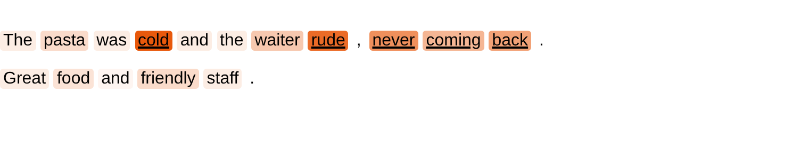

Quick Start
===========

Document-level detection
------------------------

Any embedding detector works on document embeddings through
:class:`~pytextad.models.wrappers.DocumentDetector`; end-to-end text detectors take the
texts directly.

.. code-block:: python

   from pytextad import DATE, SIK, DocumentDetector, SentenceEmbedder

   det = DocumentDetector(SIK(), embedder=SentenceEmbedder("bert-base-uncased"))
   det.fit(train_texts)
   scores = det.decision_function(test_texts)   # higher = more anomalous
   labels = det.predict(test_texts)             # 0 / 1

   scores = DATE().fit(train_texts).decision_function(test_texts)

Token-level detection
---------------------

:class:`~pytextad.models.wrappers.TokenDetector` fits an embedding detector on the sub-word
vectors of all training documents and scores every sub-word. The scores of a word's
sub-words are combined into the word's score (maximum by default), and word scores into
the document score.

.. code-block:: python

   from pytextad import TokenCore, TokenDetector, TokenEmbedder

   emb = TokenEmbedder("bert-base-uncased")   # one vector per sub-word
   det = TokenDetector(TokenCore(), embedder=emb, aggregation="max")
   det.fit(train_words)                       # documents as lists of words
   word_scores = det.token_scores(test_words) # one score per word
   doc_scores = det.decision_function(test_words)

The words of a document are only used to combine scores: the vectors are those of the
running text, so grouping words differently (for example an annotated span "not fresh"
given as one item) changes which sub-word scores are combined, not the scores themselves.

.. note::

   TokenCore as published :cite:`cao2026tokencore` pools the sub-word vectors of each item
   first (element-wise maximum) and scores the pooled vector. To reproduce it, use
   ``TokenEmbedder("bert-base-uncased", word_pooling="max")``. With that setting, an item
   made of several words (an annotated span) is scored as one pooled vector, so the way the
   annotation groups words influences the vectors.

Seeing the token scores
-----------------------

:func:`~pytextad.visualize.highlight` colours every word by its score; in Jupyter the result
is shown directly, and ``.save("scores.html")`` writes a web page. With ``labels``, the words
labelled anomalous are underlined, to compare the scores with the ground truth.

.. code-block:: python

   from pytextad import highlight

   docs = test_words[:5]
   highlight(docs, det.token_scores(docs), labels=test_labels[:5])

(Illustration with made-up scores.)

Using your own embeddings
-------------------------

Vectors you have computed yourself (any model, TF-IDF, ...) can be used without an
embedder.

**Document level.** Every embedding detector takes a ``[n_documents, dim]`` array
directly; no wrapper is needed.

.. code-block:: python

   import numpy as np
   from pytextad import SIK

   X_train = np.load("train_doc_vectors.npy")          # [n_train_documents, dim]
   X_test = np.load("test_doc_vectors.npy")
   det = SIK().fit(X_train)
   doc_scores = det.decision_function(X_test)          # higher = more anomalous
   doc_labels = det.predict(X_test)                    # 0 / 1

:class:`~pytextad.models.wrappers.DocumentDetector` is only needed

* to embed texts on the fly (``embedder=SentenceEmbedder(...)``), or
* to give a detector that only has ``fit`` and ``decision_function`` (for example your own
  class) a ``predict`` method, a ``threshold_`` and seeding, so that it can be used like
  the others, for example in :func:`~pytextad.metrics.evaluate`.

**Token level.** :class:`~pytextad.models.wrappers.TokenDetector` is needed: it fits the
detector on the tokens of all training documents together, splits the scores back per
document, and aggregates them into document scores.

.. code-block:: python

   from pytextad import TokenCore, TokenDetector

   # one [n_tokens, dim] array per document
   det = TokenDetector(TokenCore()).fit(train_token_vectors)
   token_scores = det.token_scores(test_token_vectors)   # one score array per document
   doc_scores = det.decision_function(test_token_vectors)

Each row is scored as one token. To score sub-words and combine their scores per word,
pass the ``(embeddings, ids)`` pair returned by ``TokenEmbedder.transform`` instead.

Detectors from other libraries
------------------------------

Any object with ``fit(X)`` and ``decision_function(X)`` on a 2-D array, higher scores
meaning more anomalous, can be wrapped. This includes the detectors of PyOD
:cite:`zhao2019pyod` (``pip install pyod``).

.. code-block:: python

   from pyod.models.ecod import ECOD
   from pyod.models.iforest import IForest
   from pytextad import DocumentDetector, TokenDetector, TokenEmbedder

   # token level
   det = TokenDetector(IForest(), embedder=TokenEmbedder("bert-base-uncased"))
   det.fit(train_words)
   word_scores = det.token_scores(test_words)

   # document level, with document vectors: use the detector directly
   doc_scores = ECOD().fit(X_train).decision_function(X_test)

   # in evaluate, wrap it so that it is fitted and scored like the others
   res = evaluate(DocumentDetector(ECOD()), X_train, X_test, doc_labels=y_test)

:func:`~pytextad.metrics.evaluate` sets ``random_state`` of the wrapped detector to each
seed, so randomised detectors such as ``IForest`` give different results per seed.
Neighbour-based detectors (``LOF``, ``KNN``) can be slow on the tens of thousands of token
vectors of a dataset.

Evaluation
----------

:func:`~pytextad.metrics.evaluate` fits a detector once per seed and reports AUROC, AP and
FPR at 95 % TPR, at the document level and, for token-level detectors, at the token level.

.. code-block:: python

   from pytextad.metrics import evaluate, format_results

   from pytextad import align_labels

   X_train = emb.transform(train_words, cache="train.npz")   # embed once, reuse
   X_test = emb.transform(test_words, cache="test.npz")
   y_test = align_labels(test_labels, X_test[1])             # words cut off by truncation dropped
   res = evaluate(TokenDetector(TokenCore()), X_train, X_test, token_labels=y_test)
   print(format_results({"TokenCore": res}))

Input of each detector
----------------------

==================  ==================================================================
Detector            ``X`` in ``fit`` and ``decision_function``
==================  ==================================================================
CVDD                list of ``[n_tokens, dim]`` arrays
RSRAE               ``[n_documents, dim]`` array
DATE                list of strings or of word lists
FATE                list of strings, with ``y`` marking labelled anomalies
DocumentDetector    ``[n_documents, dim]`` array, or texts when given an embedder
TokenDetector       list of ``[n_tokens, dim]`` arrays, or texts when given an embedder
==================  ==================================================================
